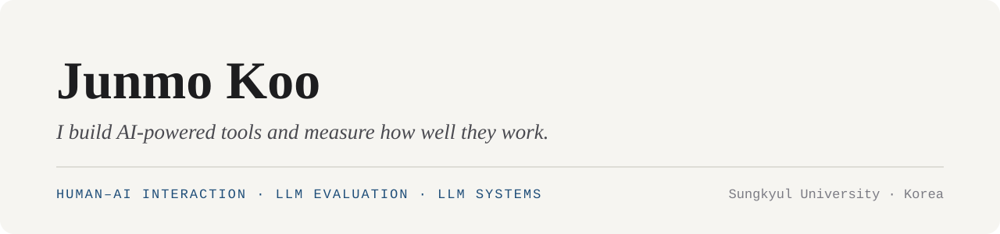

  

I'm a third-year Computer Engineering student at Sungkyul University in Korea. I build AI-powered tools, then measure where they work and where they fail for the people using them.

**How I work:** I write the specification, direct AI coding agents (Claude Code, Codex), and verify the result with tests and measurements.

### Now

- Looking for a research internship starting in January 2027 (Human–AI Interaction · LLM Evaluation · LLM Systems)
- Leading **SoonGongDan**, a capstone project that measures focused study time with on-device face detection (team of 3)
- Taking Machine Learning and Operating Systems

### Selected projects

**📖 [BookLens](https://github.com/KooGitKooGit9/booklens)** &nbsp;·&nbsp; macOS · Swift · on-device OCR · local LLM 
Explains a word in context from screen pixels, even in copy-protected e-books. 496/496 test words recognized; the meaning appears in 1.0–1.3 s.

**🔎 Mystery Soup** &nbsp;·&nbsp; private · iOS · TypeScript · Gemini 
An iOS mystery game judged by an LLM. A five-script evaluation suite caught fixes that broke other cases, and a no-new-facts rule cut serious answer leaks from 12 to 0.

**🤝 [TeamFlow](https://github.com/KooGitKooGit9/teamflow)** &nbsp;·&nbsp; Node.js · 7 Claude Code agents in tmux 
I led seven parallel Claude Code agents to rebuild a team app; the agents' rules, API contract, and status log are published.

**🏙️ [Rehearsal City](https://github.com/KooGitKooGit9/rehearsal-city)** &nbsp;·&nbsp; FastAPI · PostGIS · React + deck.gl · team lead 
Should I sign this shop lease? A break-even check against measured sales nearby, from Seoul open data.

**🍳 [AI Cooking Coach](https://github.com/KooGitKooGit9/ai-cooking-coach)** &nbsp;·&nbsp; Python · Gemini · phone camera 
A phone camera and Gemini judge cooking timing and speak the next step; replay tools test the timing against a person (±10 s).

**🃏 [Ttalkkak Voca](https://github.com/KooGitKooGit9/software_engineering)** &nbsp;·&nbsp; React · Supabase · course team of 3 
A deployed flashcard vocabulary app with wrong-answer review. I led development.

**🧩 [Nexus](https://github.com/KooGitKooGit9/nexus)** &nbsp;·&nbsp; React · TypeScript · Node.js 
A team-workspace SaaS built by coordinating parallel AI agents.

### Tools

### Contact

📫 junmokoo020902@gmail.com
